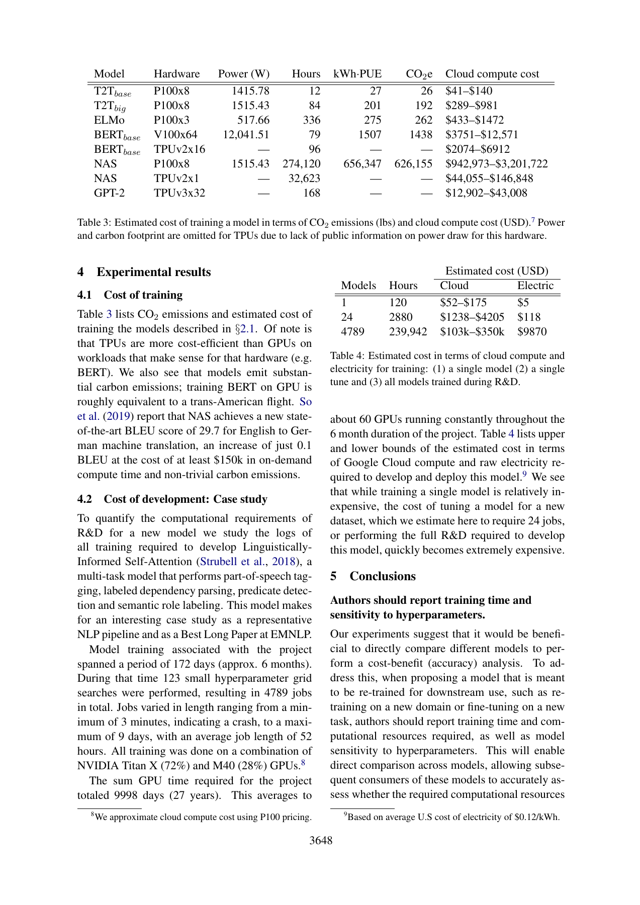

# 跟着一条证据走完：BERT 的 79 小时为何算不出表中排放？

这是本仓库中可以单独阅读和复算的完整案例。主论文为 Strubell、Ganesh、McCallum（ACL 2019）的 *Energy and Policy Considerations for Deep Learning in NLP*，采用 ACL Anthology P19-1355 的六页版。原件、全部真实模型输入输出及日志均在仓库内。

## 1. 真实输入与实践记录

[原任务](experiments/energy/cases/A/task.md)要求复算 Table 3 全部有功率行，审查“一个 Transformer 产生 626155 公斤碳排”的引用，并判断本地合计 IT 功率和设施电表是否应重复使用 PUE。[完整提示](experiments/energy/runs/A1-with/prompt.txt)、[原始模型事件](experiments/energy/runs/A1-with/events.jsonl)、[会话元数据](experiments/energy/runs/A1-with/session.json)、[实际输出](experiments/energy/runs/A1-with/out/report.md)可以直接查看。

A1 有 Skill 实际用时 178.236 秒；独立无 Skill 会话用时 221.178 秒。宿主是 Codex CLI 0.163.0-alpha.11.1，准确服务端模型快照和账单不可得。这里展示一次真实阅读过程；其是否优于基线需要看后面的复测，而不能只根据首次省时得出结论。

## 2. 原文：先读行列与单位，再读上下文

[原 PDF](experiments/energy/materials/acl-energy.pdf)第 4 页（印刷页 3648）Table 3 的 BERTbase / V100×64 行给出：功率 12041.51 W，时长 79 h，设施能量 1507 kWh，排放 1438 lb。表注把排放标为 **lbs**，且注明 TPU 能耗因缺少公开信息而省略。



图来自上述论文，CC BY 4.0，作者署名和许可见 [SOURCES.md](SOURCES.md)。保留整页便于核对列标题、相邻文字与脚注。

第 2 页式 (1)(2) 使用 PUE 1.58 与历史美国排放因子 0.954 lb/kWh；这些是论文采用的估计条件。第 3 页 BERT 段则明确写 **“3.3 days (79.2 hours)”**，对应 64 张 V100。不要把该 GPU 情景与同段另一种 TPU 配置混为一谈。可在[保存的原文提取](experiments/energy/materials/acl-energy.txt)搜索该短句核对。

## 3. 确定性复算：保留未通过的检查

对表内总功率使用以下计算，不再乘硬件列的卡数：

```python
from decimal import Decimal as D
for hours in ('79', '79.2'):
    energy = D('12041.51') * D(hours) * D('1.58') / D('1000')
    print(hours, energy, energy * D('0.954'))
```

| 输入时长 | 设施能量 kWh | 历史情景排放 lb | 能否取整为表内 1507 / 1438 |
| --- | ---: | ---: | --- |
| 表内 79 h | 1503.0212782 | 1433.8822994028 | 不能 |
| 正文 79.2 h | 1506.82639536 | 1437.51238117344 | 能 |

本轮重新检查了全部五个有功率行，只有 BERT 的表内名义时长不能经最终整数取整重现两列；[case-recheck.json](verification/case-recheck.json)记录这次作者侧复核、逐行数值和原件/报告哈希。这是对既有材料的新核查，没有伪装成新一组独立模型实验。

## 4. 实际 AI 输出与作者判断分别是什么

[A1-with 原始报告](experiments/energy/runs/A1-with/out/report.md)写道：

> 因此有来源支持“小时显示精度能解释差异”，但无法据此断言作者的内部计算就是如此，也不应武断认定表中科学估计已获验证。

[独立 A1-without 报告](experiments/energy/runs/A1-without/out/report.md)也找到了 79.2 小时，并指出：

> 没有底稿，仍不能断言作者实际计算路径，也不应武断称其能耗计算错了。

作者判断：这两段得到原文和复算支持。79.2 是有原文依据的解释；仅凭取整兼容，不能证明原始测量正确、跨硬件外推可靠或作者真实计算流程。两种条件都发现该解释，因此这条发现也不能充当有 Skill 相对基线的独有增益。

## 5. 同一次实践中的另外两个边界

**单位与预算。** 626155 对应 NAS 搜索的 GPU 等效情景，单位为 lb；Transformer big 单次训练另为 192 lb。原始报告纠正了任务中故意给出的错误引用。不能只把 lb 换为 kg，仍把整个搜索归为单模型一次训练；也不能把外推当成电表实测。

**PUE 与计量边界。** 合计 IT 功率 1.51543 kW 持续 84 h，得到 127.29612 kWh；条件乘 1.58 得到 201.1278696 kWh。若 201 kWh 已是同作业同时间段可归属的完整设施电量，就不能再乘 PUE。套历史因子可算 191.754 lb，但本地实际排放仍未知。计量覆盖与归属不清时，不能仅因两值接近就宣称验证了 PUE。

## 6. 为什么不据此宣称提效

保持版本与任务不变的第二组对照中，有 Skill 用时 258.498 秒，无 Skill 为 168.440 秒，方向反转。两组平均有 Skill 慢 12.1%；这两个小样本既不能证明长期必慢，也没有建立稳定的质量收益。四组对照、14 次会话的完整跨案例分析见 [ARTICLE.md](ARTICLE.md)，数据来自 [verification/results.json](verification/results.json)。首次正结果、复测反例、历史小错与失败记录全部保留。

## 7. 如何在自己的机器复做

1. 本地打开原 PDF 第 4 页，确认 BERT 行、列单位与缺失值；再看第 3 页 BERT 段的 79.2 小时。只有数字相同不够，须确认同一硬件情景。
2. 执行上面的 Decimal 片段，或运行 `python3 quick_check.py` 复算全部保存账本并核对原始会话统计。该脚本只依赖标准库，不需要模型账号。
3. 将得到的两组 BERT 数值与上表及原报告对照，保留 79 h 检查失败，不覆盖成 79.2 h 后声称原表直接通过。
4. 如需重新运行 AI，使用自己的认证，按 [REPRODUCE.md](REPRODUCE.md)在新目录使用原任务和输入，保存新日志。原运行的模型快照未知，不能承诺逐字复现。

本案例的贡献是把“读取原文—表格与上下文核对—十进制复算—限定结论—公平复测”的证据链直接展开；它不靠读者联网或先遍历四百多个文件才能理解。代码只验证录入数据和算术，语义、物理测量及方法外推须单独判断。
