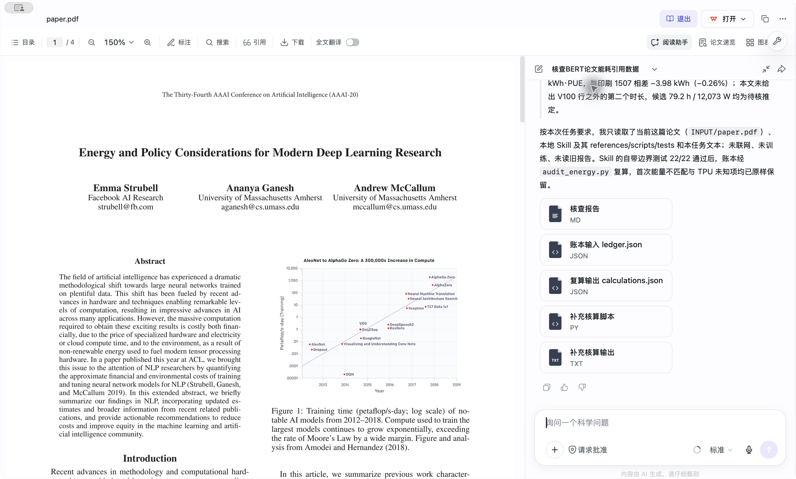

# AI算对了，引用仍会错：一次能耗论文的来源与舍入核查

同作者的两篇论文都列出BERT训练电量1507kWh，排放却分别为1438lb与719lb。读者应引用哪一个？排放减半是否代表硬件耗电减半？我们在玻尔科学空间实际读论文、运行计算、核查原文，发现最危险的错误往往出现在**把计算结果写回最终引用句**的环节。

这篇分享解决一个小问题：**怎样把一段混入他文数字、取整和来源推断的引用笔记，改成有证据边界的引用说明？** 真实AI首答及修订错误全部保留。最终可用的[作者引用短笺](citation-brief.md)将表列事实、条件推导与未知分开；无需接受AI最后一句“已核查”。

## 阅读入口与本次贡献

| 想做什么 | 从这里开始 |
| --- | --- |
| 看可以实际采用的结论 | [引用短笺](citation-brief.md)，逐项对应原文和作者核算 |
| 看最新真实全文实践 | [首答前冻结设计](transfer/design-frozen.json)、[实际提示](transfer/prompt.txt)、[完整AI交付报告](transfer/actual-artifacts/audit_report.md)、[作者判定](transfer/author-review.md) |
| 检查“修好以后仍错” | [实际诊断问题](transfer/repair-prompt.txt)、[完整AI诊断交付](transfer/actual-artifacts/repair_notes.md)；原五份文件未覆盖 |
| 核对关键原文 | [2020必要裁片及位置说明](transfer/source/README.md)、[2019必要原文与页面](INPUT/acl2019-evidence.md) |
| 无模型、无网络复算 | `python3 recheck.py`，执行并比对原账本、生成脚本及作者核算 |

本次新增：将核查流程整理为Skill1.2.0，在**完整AAAI2020原文的新可见会话**中实际使用，并保留首次失败、事后诊断和量纲错误；补充精确的联合舍入核算。此前2019同题A/B保留为前置失败证据。本次提交不再纳入旧Codex数值项目的复现主张和材料；旧94分固定版本保持不变，未把旧轨迹说成新操作。

## 两篇相近论文，不能拼成一个来源

| 作品与原文位置 | BERT显示值 | 原文方法与能说明的事 |
| --- | --- | --- |
| Strubell等，*Energy and Policy Considerations for Deep Learning in NLP*，ACL2019，P19-1355；PDF4/印刷3648 Table3 | V100×64，12041.51W，79h，1507kWh，1438lb | 方法PDF2给PUE1.58、0.954lb/kWh；正文PDF3另给79.2h。必要事实转录与2/3/4页原文页图随包。 |
| 同作者，*Energy and Policy Considerations for Modern Deep Learning Research*，AAAI2020，34(09)，13693–13696；PDF3/13695 Table2 | 同一行列1507kWh，排放719lb | PDF2/13694式(2)用0.477；按更新的AWS50%可再生假设，将0.954减半，并假定剩余来源比例类似美国。PDF2的BERT段没有79.2。 |

两行的电量显示相同，只说明两份估计表显示相同。没有新测量就不能说真实硬件能耗没变，更不能从排放因子减半推出省电一半。0.477也不是当前任意地区的实测电网强度。来源、版本、哈希、授权与贡献见[SOURCES.md](SOURCES.md)。2020全文仅用于本次实际阅读，不假定再分发权；核查关键解读所需的表头、相关行、表注、方法与BERT段均以必要裁片本地提供。

## 为什么先留住失败，再让AI改

之前的2019阅读暴露了两个不同层级的问题，不能靠“让模型更认真”合在一起处理：

1. **算术层**：精确79小时复算不等于表值。普通提问A虽运行了脚本，却认定79.2是唯一解释；同题B反解了舍入区间，纠正了唯一性。
2. **来源层**：B又用T2Tbig与BERT两行拟合共同CPU/GPU参数，把拟合写成测量机制。未参与拟合的T2Tbase预测残差为99.65W。反例否定的是共同参数模型，不能证明另一种实际生成路径。

原始[A](matched/A-final-ax.txt)、[B](matched/B-final-ax.txt)及[B事后来源诊断](matched/B-repair-answer-ax.txt)均随包。前一对在A发送前冻结八项标准，见[完整判定矩阵](matched/author-review.json)；后续来源诊断不混进首答比较。A/B仅同论文、同题、相同可见“标准”模式；顺序固定、未盲评、未重复采样，后端与缓存未控制，因此不声称因果提升或平台准确率。

我们据此修订了[Skill1.2.0](skill/SKILL.md)：事实绑定具体文章；未知数字不从邻文记忆补齐；两点拟合须检查共享参数与未参与拟合行；否定一种机制后停在未知。Skill含标准库核算脚本、账本字段说明和22项输入边界测试。测试核算行为，不测试论文理解；不能拿22/22证明AI阅读全对。

## 最新实践：新会话读完整2020论文

在玻尔科学空间0.10.12的文献阅读中本地导入4页AAAI2020原PDF，确认题名后打开新可见会话。模型收到当前完整论文、实际任务及本机Skill路径；未显式提供旧答案。先冻结[8项检查](transfer/design-frozen.json)，再发送[实际完整提示](transfer/prompt.txt)。它针对已知风险设计，是一篇同作者邻近文章的定向检验，不是盲测或广泛泛化验证。

任务里的“实测1507与1438”“因子减半即耗电减半”“NAS同值证明复制”“TPU空白等于零”均为作者构造的待核笔记，不是作者相信的科学结论。首答界面用时6m27s，后续5m18s，仅记录操作，不作速度比较。安装版本、可见模式、文件哈希和未控制因素见[provenance.json](transfer/provenance.json)。准确后端快照、温度、种子和费用未披露，不猜测。

首答正确识别AAAI2020/Table2/719，保留79小时复算失败；79.21被标作条件候选，没有称2020正文给了79.2；TPU缺失返回unknown，也没有据相同功率认定复制。但最终引用仍有精确等号、来源链和量纲问题。完整[AI报告](transfer/actual-artifacts/audit_report.md)保留原样，首答的八项[逐项作者判定](transfer/author-review.md)不简化成“7/8准确率”。



截图是阅读助手交付文件的一个完成视口，不代表完整消息。AX导出[首答](transfer/first-answer-ax.txt)、[诊断](transfer/repair-answer-ax.txt)有长静态字段截断；完整AI交付的MD另附，不声称与UI最终消息逐字相同，不发布隐藏处理过程。生成文件来自界面实际显示的会话路径，复制后验证原字节；`recheck.py`的执行是作者回放，不冒充模型原生STDOUT。模型声称不联网，不等于我们取得完整网络遥测。

## 发现一：一个false没有排除所有舍入解释

采用表列合计IT功率作**条件复算**，不再乘64，PUE只乘一次：

```text
E = 12041.51 W ÷ 1000 × 79 h × 1.58 = 1503.0212782 kWh
C = E × 0.477 lb/kWh = 716.9411497014 lb
E − 1507 = −3.9787218 kWh
```

这既不复现1507，也不复现719。首答正确保留了不匹配，但账本没有quantum。原计算器把区间退化为两个点；字段`conditional_rounding_overlap=false`只否定该点输入假设，不能翻译成“考虑了显示精度仍然不匹配”。

在明确标注的事后诊断中，模型实际另存了两套候选，没有覆盖首答：

| 候选，均非原文精度声明 | 可直接检查的输入/输出 | 该次结果的含义 |
| --- | --- | --- |
| 仅duration加quantum=1h | [账本](transfer/actual-artifacts/ledger_quantum_1h.json)、[结果](transfer/actual-artifacts/calculations_quantum_1h.json) | 计算能量闭包络约[1493.5085,1512.5341]kWh，含1507；该条件未被排除 |
| 仅reported_energy加quantum=1kWh | [账本](transfer/actual-artifacts/ledger_quantum_reported_kwh.json)、[结果](transfer/actual-artifacts/calculations_quantum_reported_kwh.json) | 报告值[1506.5,1507.5]仍不含1503.0212782；仅舍入报告列不足 |

前一结果不识别实际时长；后一结果也不能给“更可能来自输入侧”排概率。原计算器是保守闭包络，严格round-half-up的上端是否包含要另算。多个输出各自overlap也不自动证明存在同一个输入使它们同时成立。

因此作者另用[Fraction脚本](transfer/author_verify.py)将Hours=79、E=1507、C=719都视为步长1的正数half-up显示，固定功率/PUE/因子，反解到同一个t再求交。精确端点和79.21反例在[结果](transfer/author-results.json)。**没有**加入另一篇正文的79.2约束。交集非空说明这个条件解释尚可行；文章未给取整实现，不能宣布其实际生成方式，也不是置信区间。

旧2019案例更严格的四约束反解及不同截断模型保留在[matched/author_verify.py](matched/author_verify.py)；正文79.2属于那篇文章，不能移作2020事实。

## 发现二：代码正确，不会自动保护最终引用

原supplementary_checks.py算出718.839、1437.678，首答却把它们写成精确等式719、1438。原calculations把碳残差统一为kg，读者若沿用表头lb会误读。原脚本题头正确列出Table2=13695，局部注释却仍写13694。检查一个来源字段不足以检查所有输出。

实际[诊断提示](transfer/repair-prompt.txt)逐项追问这些缺口；模型新增[repair_notes.md](transfer/actual-artifacts/repair_notes.md)和计算文件，修正精确值、统一单位、以及“本次没有读ACL2019原表”的边界。原五份文件逐字节未变。但是它又说718.839“正是作者取整来源”，且在最终文字公式中丢了W→kW的`/1000`。这是**算式到结论的证据与量纲丢失**，不能靠程序退出0发现全部语义错误。

作者不采纳这些新断言。允许的说法是“显示1507乘0.477得到718.839，可舍入到719”；不允许“原作者先舍入电量再算排放”。同样，方法有合计功率公式与采样描述，不等于拿到了这64卡这一行的分项日志。完整采纳/拒绝清单见[作者核查](transfer/author-review.md)。

## 发现三：第三行能否定拟合，不能补出来源

2019的B用T2Tbig(P100×8,1515.43W)和BERT(V100×64,12041.51W)拟合`Power=a+g·b`。两个参数拟合两点并非来源证据；P100/V100及负载能否共享参数也未由原文确立。

未参与拟合的T2Tbase(g=8,1415.78W)预测为1515.43W，差99.65W；NAS与拟合点具有相同g，不能提供新增区分力。原始反例及结果在[probe_shared_power.py](matched/probe_shared_power.py)、[power-probe.json](matched/power-probe.json)。它只否定这个明确的全表共同参数模型。旧后续回答改称“逐行各自取功率”仍没有日志支持，作者拒绝。流程的停止条件必须延续到最终引用，而不是从一个故事换成另一个。

## 在玻尔照着做：步骤与验收

1. 从[官方页](https://ojs.aaai.org/index.php/AAAI/article/view/7123)取得2020PDF，核对[原件哈希](transfer/source/source-record.json)和4页。文献阅读→本地导入→打开当前题名→新建对话。没有全文时，只能核查本包片段范围，不能说自己重做了全文阅读。
2. 将本包解压；用实际本机路径替换transfer/prompt.txt首段Skill绝对路径，指向本包skill/SKILL.md。任务保持原样，当前PDF只给2020原件。标准模式是本次可见设置，不承诺指定后端；需要自己的账户及文件权限，费用未知。
3. 等完成后下载交付文件，保留原始MD、账本、脚本及结果。核对Table2在PDF3/13695、方法在PDF2/13694、估算流程在PDF1/13693。若模型拿不到本地PDF，先解决访问，不把解析完成图标当正文已读。
4. 对照冻结8项检查，特别看最终引用是否保留单位、具体文章及未知；不要只看账本status=ok。若首答错误，另发repair-prompt.txt，明确新文件另存，并标注为事后诊断。先验检查与事后修订分别报告。
5. 执行下方离线复核，检查实际输入输出一致；再人工核对[引用短笺](citation-brief.md)。如果模型输出不同，按原标准记录差异，不追求和本次措辞一致。不声称工具复算替代语义审核或科学复现。

```sh
python3 recheck.py
# 只需Python3标准库；不调用模型、不联网，不安装依赖
python3 transfer/author_verify.py
# 需要重新进行全文阅读时才下载官方2020PDF；完整PDF不随包再分发
```

`recheck.py`在临时目录重算3份新账本，运行两个真实生成的计算脚本并比较保存输出，复跑此前三个AI脚本、两种联合约束与功率反例、版本因子核算、22项输入测试，并校验材料哈希。没有把模型报告的语义断言写成必过测试。作者侧的文件一致性、离线复算和原文人工核查是三种不同验证。

## 适用范围、贡献与下一步证据

这里没有新训练或能耗测量。两份同作者邻近文章、构造问题、固定顺序、单次定向全文检验，都不足以证明流程稳定、普适或更快更便宜；新Skill检查也不和旧无Skill回答做公平因果比较。所需进一步证据是原作者逐行功率来源、采样配置/日志、实际未舍入时长与内部取整方式，以及具体核算任务的地区、时间和计量边界，不是更多无来源的精确小数。

本次个人贡献是：保留真实失败、明确模型与作者操作边界，把“版本→单位→条件舍入→来源→最终引用”的检查写成可复用流程，并给出自包含证据及可运行反例。论文原文、玻尔输出、作者判断分开。旧材料仅按已发表固定版本继承；未以新目录冒充新实验。公开作品及提交包按同一commit定版，变更见[CHANGELOG.md](CHANGELOG.md)。
